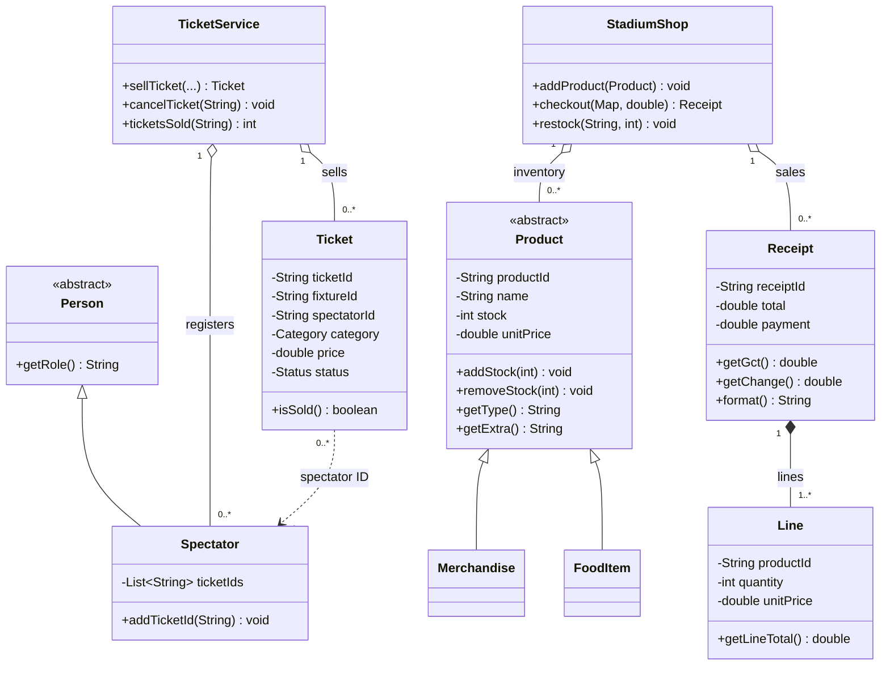

# Member 4: Ticketing, Stadium Shop & Payment

All classes are in `src/main/java/kpfl/`. `model` holds the data classes and `service` holds the classes that run the sales.

| Class | Package | Purpose |
|---|---|---|
| `Spectator` | model | Extends `Person`. A match-day buyer. Keeps the IDs of the tickets bought. `getRole()` returns `"Spectator"`. |
| `Ticket` | model | One ticket: ticket ID, fixture ID, spectator ID, category (`GENERAL` or `VIP`), tax-inclusive price and status (`SOLD` or `CANCELLED`). |
| `Product` | model | Abstract parent of everything the shop sells: product ID, name, stock and tax-inclusive unit price. |
| `Merchandise` | model | Extends `Product`. Jerseys, flags and similar items, with an optional size. |
| `FoodItem` | model | Extends `Product`. Food and beverages. |
| `Receipt` | model | A completed shop sale with its lines, totals, payment, change and printable text. |
| `Money` | model | Rounding, GCT extraction and `J$` formatting. |
| `TicketService` | service | Holds spectators and tickets. Sells and cancels tickets and counts tickets sold per fixture. |
| `StadiumShop` | service | Holds the inventory. Completes multi-item sales, deducts stock and keeps the sales list. |

## Product inheritance (second inheritance hierarchy)

`Product` is abstract, so no one can create a plain `Product`. It holds what every item has in common (ID, name, stock, price) and the stock rules (`addStock`, `removeStock`). It declares two abstract methods that each child must supply:

* `getType()` says what kind of product it is.
* `getExtra()` gives the one extra value that is saved to file.

| Class | `getType()` | `getExtra()` |
|---|---|---|
| `Merchandise` | `"Merchandise (size L)"`, or `"Merchandise"` when there is no size | the size |
| `FoodItem` | `"Food"` or `"Beverage"` | `true` for a drink, `false` for food |

**Polymorphism:** the shop stores everything as `Product`. When code calls `product.getType()` on a `Product` variable, Java runs the child's version, so a jersey, a jerk chicken box and a bottle of water each describe themselves correctly without any `if` checks.

```java
for (Product p : shop.getInventory()) {
    System.out.println(p.getType() + " -> " + p.getName());
}
```

`Spectator` follows the shared Person contract: it calls `super(id, name, age, gender)` and overrides `getRole()`.

## Business rules

* **Capacity:** tickets are counted per fixture, not per stadium. A sale is rejected when the number of `SOLD` tickets for that fixture reaches the stadium capacity. Cancelling a ticket frees its seat.
* **Ticket price:** the stadium's base ticket price is multiplied by the category (`GENERAL` = 1x, `VIP` = 2x). A ticket cannot be sold for a fixture that has already been played.
* **GCT:** all prices already include 15% GCT, so GCT is taken out of the total and never added on top: GCT = total x 15/115. A J$1,150 total gives J$1,000 before GCT and J$150 GCT.
* **Shop sale:** a basket may hold several items. Quantities must be positive and in stock, and the payment must cover the total. Everything is checked first and stock is only deducted when the whole sale is valid, so a failed sale changes nothing.

## Sales-record format (saved by `FileStorage` in `data/`)

One record per line, fields separated by `|`. Links are saved as IDs and rebuilt on load.

| File | Columns | Example |
|---|---|---|
| `spectators.txt` | `id\|name\|age\|gender` | `SP001\|Tanya Morgan\|29\|F` |
| `tickets.txt` | `ticketId\|fixtureId\|spectatorId\|category\|price\|status` | `TK0002\|F003\|SP002\|VIP\|3000.0\|SOLD` |
| `products.txt` | `kind(M/F)\|id\|name\|stock\|unitPrice\|extra` | `F\|B001\|Bottled Water\|197\|250.0\|true` |
| `sales.txt` | `receiptId\|dateTime\|payment\|productId:qty:unitPrice;...` | `R0002\|2026-11-24T22:32:20\|5000.0\|M002:2:1500.0;B001:3:250.0` |

## Sample receipt

```
---------- KPFL STADIUM SHOP ----------
Receipt R0002  2026-11-24 22:32
Team Flag               2 x J$1,500.00 =   J$3,000.00
Bottled Water           3 x   J$250.00 =     J$750.00
Subtotal (before GCT)                    J$3,260.87
GCT 15% (included)                         J$489.13
TOTAL                                    J$3,750.00
Paid                                     J$5,000.00
Change                                   J$1,250.00
---------------------------------------
```

## UML (Member 4 classes)



## Tests

`src/test/java/kpfl/Member4Tests.java` has 41 checks. The test output is in `docs/member4-evidence.txt`.

Compile the project, then run:

```bash
javac -d out -encoding UTF-8 $(find src/main -name "*.java")
javac -d out -cp out src/test/java/kpfl/Member4Tests.java
java -cp out kpfl.Member4Tests
```

| Required test | Result |
|---|---|
| A stadium with 2 seats accepts exactly 2 ticket sales and rejects the third | PASS |
| Capacity is counted per fixture (another fixture is unaffected) | PASS |
| VIP costs double; cancelling a ticket frees a seat | PASS |
| Valid shop payment succeeds and change is correct | PASS |
| Insufficient payment is rejected and stock is unchanged | PASS |
| Negative and zero quantities are rejected | PASS |
| Exhausted stock is rejected; one bad item cancels the whole sale | PASS |
| Stock reduces correctly after a sale; restock adds stock | PASS |
| GCT: J$1,150 gives J$1,000 + J$150 (not added twice) | PASS |
| `Product` reference calls the child's `getType()` | PASS |

## Weekly contribution log (Member 4)

| Week | Planned in the team plan | What I did / evidence |
|---|---|---|
| 1 | Agree the design, IDs and `Person` contract | _(to fill in)_ |
| 2 | `Product` hierarchy and sample inventory | _(to fill in)_ |
| 3 | Ticket model and sample records | _(to fill in)_ |
| 4 | Ticketing, shop and receipts | _(to fill in)_ |
| 5 | Integration, tests, demo | _(to fill in)_ |
