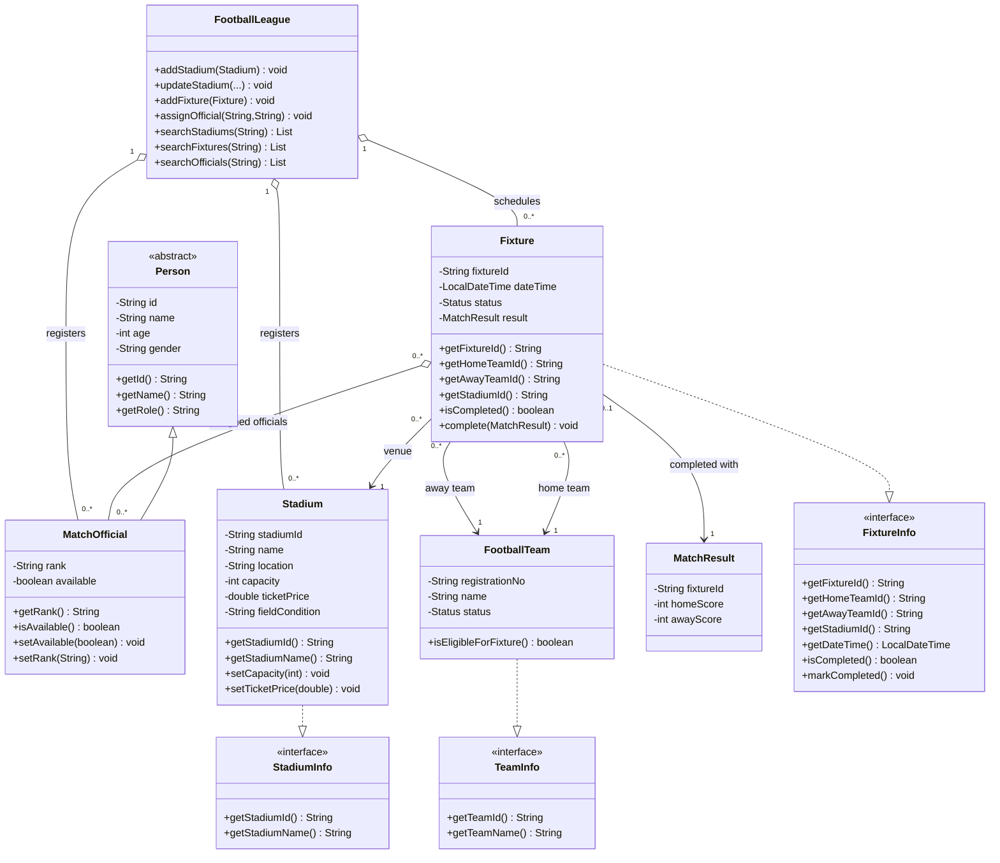

# Member 3 UML Class Relationships

The diagram below describes the Member 3 domain classes and their relationships to the shared league classes. `FootballLeague` coordinates registration and scheduling; the model classes own their own data and validation.

## Relationship notes

- `MatchOfficial` inherits identity and personal details from the abstract `Person` class.
- `Stadium`, `Fixture`, and `FootballTeam` implement their corresponding integration interfaces so other modules depend on stable contracts.
- Each `Fixture` references exactly one home team, one away team, and one stadium. The teams must be different and registered/eligible before scheduling.
- A fixture can have zero or more assigned officials. An official cannot be unavailable or assigned to another fixture at the same date and time.
- A fixture has at most one result. It is marked completed only when a valid result is linked.
- `FootballLeague` owns the registries and coordinates uniqueness and scheduling-conflict checks.
